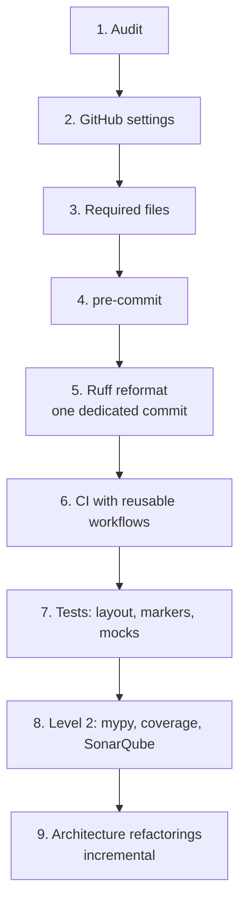

# Migration playbook

## TL;DR

- This page explains how to bring an **existing** repository to Level 1, then Level 2, **without blocking the contributors**.
- Follow the steps **in order**: each step makes the next one easier and creates fewer conflicts.
- **One PR per topic.** Never a "big bang" PR that changes everything.
- **Warn the authors of open PRs** before a change that touches many files, and **freeze merges** during the mass reformat.
- Turn every finding of the audit into an issue, so the migration is a visible backlog.

## Overview



| Step | Level | Typical effort | Touches code? |
|---|---|---|---|
| 1. Audit | — | 2–4 h | no |
| 2. GitHub settings | 1 | 1 h | no |
| 3. Required files | 1 | 0.5–1 day | no |
| 4. pre-commit | 1 | 2 h | config only |
| 5. Ruff reformat | 1 | 2–4 h + freeze | **every file** (formatting only) |
| 6. CI | 1 | 0.5 day | config only |
| 7. Tests | 1 | 1–3 days | tests |
| 8. mypy, coverage, Sonar | 2 | 1–2 weeks, PR by PR | yes |
| 9. Architecture | 2 | weeks, PR by PR | yes |

## General rules for the migration

1. **One PR per topic**, with a clear Conventional Commits title: `ci: use the DAH Labs reusable workflows`, `docs: add SECURITY.md`. A reviewer can approve each one in minutes.
2. **No "big bang".** A PR that adds files, reformats the code, moves tests and changes CI cannot be reviewed and creates conflicts with every open PR.
3. **Warn contributors.** Before steps 5, 7 and 9, comment on every open PR: what will change, when, and how to update their branch.
4. **Freeze merges** during the mass reformat (step 5): no other PR is merged between the start and the end of that step.
5. **Configuration before code.** Steps 2, 3, 4 and 6 do not change application code, so they create almost no conflicts.
6. **Do not mix behavior changes with migration changes.** If you find a bug during the migration, open an issue and fix it in its own PR.
7. **Security first.** If the audit finds a leaked secret or exposed personal data, stop and follow [SEC-004](../standards/security.md#sec-004-no-secret-is-ever-committed-and-a-leaked-secret-is-revoked-first) before anything else. Report it privately, never in a public issue.

## Step 1 — Audit

1. Open an issue with the **Compliance audit** form (copy [`audit.yml`](../../templates/github/ISSUE_TEMPLATE/audit.yml) to the repository first, or write the issue by hand).
2. Follow the [audit checklist](audit-checklist.md). Run the automatic part:

   ```bash
   python scripts/audit_repository.py DAH-Projects-and-Innovations/<repo>
   ```

3. Write one line per non-compliant rule: rule ID, current state, action, effort (S/M/L), priority.
4. Write security findings **only** in a private security advisory (Security → Advisories → New draft advisory).
5. Convert each action into an issue (label `compliance-audit` and `size: …`), and link them from the audit issue. A list in the audit issue with `- [ ] #123` gives a progress bar.

## Step 2 — GitHub settings

No code change. Done by a repository admin. See [GitHub settings](../standards/github-settings.md).

1. Repository description, topics (`dah-labs`, …).
2. Merge settings: squash only, PR title and description, delete branches automatically (`gh api --method PATCH …`, GH-004).
3. Security: Dependabot alerts and security updates, secret scanning, push protection, private vulnerability reporting (SEC-001, SEC-003, SEC-008).
4. Labels: `python scripts/sync_labels.py DAH-Projects-and-Innovations/<repo>`.
5. Default branch: if it is not `main`, follow the [default branch migration](default-branch-migration.md). This is the only part of step 2 that needs communication.
6. Ruleset: import [`main.json`](../../templates/github/rulesets/main.json) **with only the checks that already exist**. You will add the new checks at step 6. A required check that never runs blocks every PR.

## Step 3 — Required files

One PR per group of files, for example:

1. `docs: add SECURITY.md, CODE_OF_CONDUCT.md and CODEOWNERS`
2. `docs: add issue forms and pull request template`
3. `chore: add .editorconfig, .gitattributes and .gitignore entries`
4. `docs: rewrite README with the DAH Labs template`
5. `chore: add dependabot configuration`

Templates are in [`templates/`](../../templates/). Keep the good content that already exists: reuse it inside the template structure instead of replacing it.

**`.gitattributes` and line endings:** if the repository already has files with CRLF line endings, `* text=auto eol=lf` will show them as modified. Run `git add --renormalize .` in the same PR and say so in the description.

## Step 4 — pre-commit

1. Copy [`python.yaml`](../../templates/pre-commit/python.yaml) or [`fullstack.yaml`](../../templates/pre-commit/fullstack.yaml) to `.pre-commit-config.yaml`.
2. **Do not enable the Ruff hooks yet** if the code is not formatted: comment them out until step 5.
3. Run `uvx pre-commit run --all-files`. The hygiene hooks fix whitespace and end-of-file problems.
4. Commit: `chore: add pre-commit hooks`. If the hygiene fixes touch many files, follow the freeze procedure of step 5 for this PR too.
5. Ask every contributor to run `uvx pre-commit install` (message in the PR and in the README).

## Step 5 — Ruff reformat in one dedicated commit

The reformat changes almost every Python file. Done badly, it creates conflicts in every open PR. Done well, it costs one short freeze.

**Before (D-7):**

1. Add the Ruff configuration (`[tool.ruff]` of the [template](../../templates/python/pyproject.toml), Level 1 rule set) in a separate PR, **without** reformatting. Commit: `build: configure ruff`.
2. Announce the date of the reformat in an issue and on every open PR. Ask authors to finish or pause.

**During (freeze, about 1 hour):**

1. Announce "merge freeze, reformat in progress".
2. Create the branch: `git switch -c style/apply-ruff-format origin/main`
3. Reformat **only**:

   ```bash
   cd backend
   uv run ruff format .
   uv run ruff check --fix --select I .   # import order only: no logic change
   ```

4. Check that nothing else changed: tests pass, and `git diff --stat` shows only Python files.
5. Commit with the exact message `style: apply ruff format` and open the PR. The review only checks that the diff contains formatting.
6. Squash merge. Copy the SHA of the commit on `main`.
7. Enable the Ruff hooks in `.pre-commit-config.yaml` and add the SHA to `.git-blame-ignore-revs` (FILE-018). Commit: `chore: enable ruff hooks and ignore the reformat in blame`.
8. End the freeze.

**After: how authors update an open PR** (copy this into each open PR):

```bash
git fetch origin
# 1. Merge main up to the commit BEFORE the reformat, and fix real conflicts normally.
git merge <sha-of-the-commit-before-the-reformat>
# 2. Merge the reformat commit, keeping your version on conflicts (they are only formatting).
git merge -X ours <sha-of-the-reformat-commit>
# 3. Format your own code with the same tool.
uv run ruff format . && git commit -am "style: apply ruff format"
# 4. Merge the rest of main.
git merge origin/main
git push
```

Then fix the Ruff lint errors (not formatting) progressively: one rule family per PR (see [PY-006](../standards/python.md#py-006-level-2-enables-the-full-dah-labs-rule-set)).

## Step 6 — CI with the reusable workflows

1. Copy [`templates/github/workflows/ci.yml`](../../templates/github/workflows/ci.yml) to `.github/workflows/ci.yml`. Keep the existing jobs that are not covered (for example integration tests with Postgres and Redis).
2. At Level 1, set `run-mypy: false` if mypy does not pass yet, and `coverage-fail-under: 0`.
3. Open the PR and check that every job is green. Fix in the same PR only what is needed for CI (for example a missing `--locked` lock file update).
4. Delete the old workflow in the same PR, or in the next one.
5. Update the ruleset: add the new check names (from the "Checks" tab of the PR), remove the old ones.

## Step 7 — Tests

1. Move tests outside the package to `tests/unit`, `tests/integration`, `tests/e2e` (PY-012). Use `git mv` so history follows. One PR, no logic change: `test: move tests to tests/`.
2. Declare markers and enable `--strict-markers` (PY-013).
3. Replace calls to real LLM or embedding providers with fakes (PY-016). One PR per provider is fine.
4. Measure coverage and set `coverage-fail-under` to the current value, rounded down (PY-017).

## Step 8 — Level 2: mypy, coverage, SonarQube Cloud

1. Enable `strict = true` with one override per failing module (PY-009). CI is green from day one; each later PR removes overrides.
2. Raise the coverage threshold each time coverage goes up.
3. SonarQube Cloud, release-please and CodeQL default setup: follow their pages when they are published (the next version of these standards).

## Step 9 — Architecture refactorings

Move the code towards the layered architecture **one module at a time** (see [Architecture](../standards/architecture.md), next version of these standards). Each PR moves one module or one port, keeps the behavior, and is covered by tests. Add an import-linter contract as soon as a layer exists, so it cannot be broken again.

## Checklist

- [ ] The audit issue exists, and each finding is an issue with a size.
- [ ] Security findings are in private advisories, not in public issues.
- [ ] Steps were done in order, one PR per topic.
- [ ] Open PR authors were warned before the reformat; the reformat commit is in `.git-blame-ignore-revs`.
- [ ] The ruleset lists only checks that exist and pass.
- [ ] The README badge shows the level reached.

---

*Last verified: 2026-11-13.*
