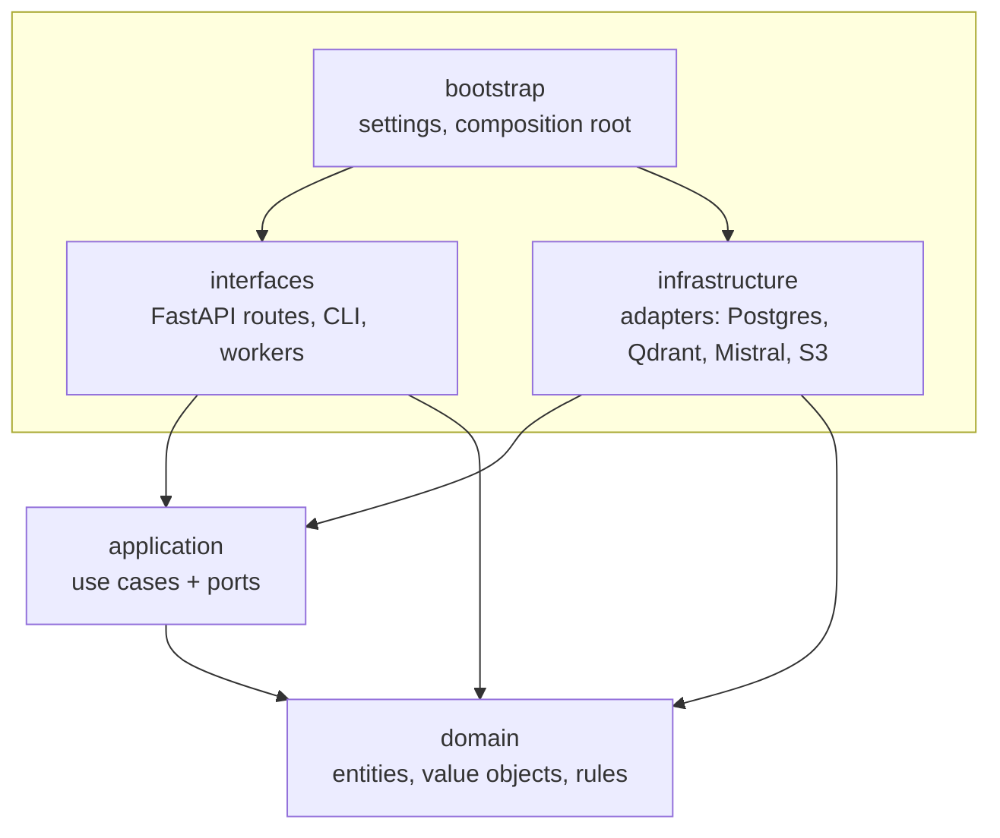

# Architecture

## TL;DR

- A DAH Labs service is split into **layers**: `domain` (business objects), `application` (use cases and **ports**), `infrastructure` (adapters: databases, LLM providers, vector stores), `interfaces` (HTTP, CLI, workers) and `bootstrap` (the composition root).
- **Dependencies point inward only**: `bootstrap` → `interfaces` / `infrastructure` → `application` → `domain`. The domain and the use cases never import a framework or an I/O library.
- Use cases talk to the outside world through **ports** (`typing.Protocol`). Adapters implement them. Tests replace them with fakes.
- One **composition root** creates the adapters from the settings and gives them to the use cases. Nothing is created at import time.
- **import-linter** checks these rules in CI (Level 2).

Reference implementation: [`examples/python-service/`](../../examples/python-service/README.md).

## The layers



| Layer | Contains | May import | Must not import |
|---|---|---|---|
| `domain` | Entities, value objects, business rules and errors, as plain Python (`dataclass`, `enum`) | the standard library | every other layer, frameworks, I/O libraries |
| `application` | Use cases (one class or function per action), **ports** (`Protocol`), DTOs | `domain` | `infrastructure`, `interfaces`, `bootstrap`, FastAPI, httpx, SQLAlchemy, SDKs |
| `infrastructure` | Adapters that implement the ports: repositories, API clients, vector stores, file storage | `application`, `domain`, any library | `interfaces`, `bootstrap` |
| `interfaces` | Entry points that translate the outside world into use case calls: HTTP routes, CLI commands, queue consumers | `application`, `domain`, the web or CLI framework | `infrastructure`, `bootstrap` |
| `bootstrap` | Settings (`pydantic-settings`), the composition root that creates the adapters and the use cases, the application factory | everything | — |

`interfaces` and `infrastructure` are **independent**: a route never imports an adapter directly; it receives a use case that already has its adapters.

### Layout of a service

```text
backend/src/<package>/
├── domain/
│   ├── model.py            # entities and value objects
│   └── errors.py
├── application/
│   ├── ports.py            # Protocol classes: Retriever, LanguageModel, DocumentRepository
│   └── answer_question.py  # one module per use case
├── infrastructure/
│   ├── qdrant_retriever.py # one module per adapter, named after the technology
│   └── mistral_model.py
├── interfaces/
│   └── http/
│       ├── app.py          # build_app(use_cases) -> FastAPI
│       └── schemas.py      # request and response models (Pydantic)
└── bootstrap/
    ├── settings.py
    ├── container.py        # the composition root
    └── main.py             # create_app() for uvicorn --factory
```

A large service MAY group these folders by feature (`<package>/documents/domain/`, `<package>/chat/domain/`), with the same rules inside each feature.

## Rules

### ARCH-001: A service is organized in layers

**MUST** · Level 2 · Verified by: code review (manual); import-linter `layers` contract (automatic)

A repository that contains a service (an HTTP API, a worker, a pipeline with external dependencies) uses the five layers above, in `src/<package>/`.

**Why:** business logic that does not depend on frameworks is easy to test, to read and to keep when a technology changes (a new vector store, a new LLM provider). Volunteers can work on one layer without understanding the others.

### ARCH-002: The dependency rule is checked by import-linter in CI

**MUST** · Level 2 · Verified by: `lint-imports` in `python-ci.yml` with `run-import-linter: true` (automatic)

`pyproject.toml` declares the contracts. Copy them from the example service:

```toml
[tool.importlinter]
root_packages = ["my_package"]
include_external_packages = true

[[tool.importlinter.contracts]]
name = "Layers: outer layers depend on inner layers, never the reverse"
type = "layers"
layers = [
  "my_package.bootstrap",
  "my_package.interfaces | my_package.infrastructure",
  "my_package.application",
  "my_package.domain",
]

[[tool.importlinter.contracts]]
name = "The domain and the application use no framework and no I/O library"
type = "forbidden"
source_modules = ["my_package.domain", "my_package.application"]
forbidden_modules = ["fastapi", "httpx", "sqlalchemy", "qdrant_client", "mistralai", "pydantic_settings"]
```

In the `layers` contract, `|` separates **independent** layers: `interfaces` and `infrastructure` cannot import each other. `include_external_packages = true` is required by the `forbidden` contract on external packages.

**Why:** an architecture that is not checked degrades at the first deadline. A failing contract shows the wrong import in the PR.

### ARCH-003: The domain and the application import no framework and no I/O library

**MUST** · Level 2 · Verified by: import-linter `forbidden` contract (automatic)

- Use `dataclass` (frozen when possible) for domain objects, not ORM models or Pydantic models.
- Use cases receive and return domain objects or simple DTOs, never `Request`, `Response` or ORM sessions.
- Pydantic is allowed in `interfaces` (request and response schemas) and in `bootstrap` (settings).

**Examples:**

- ✅ `def __call__(self, question: Question) -> Answer:` in `application/answer_question.py`
- ❌ `from fastapi import HTTPException` in `application/` (the use case now depends on HTTP)

### ARCH-004: One composition root creates the adapters; nothing is created at import time

**MUST** · Level 2 · Verified by: code review (manual)

- `bootstrap/container.py` reads the settings, creates the clients and adapters, and builds the use cases.
- Modules do not create clients, connections or settings at import time (`client = Mistral(api_key=os.environ[...])` at module level is forbidden).
- The web application is built by a factory (`create_app()`), started with `uvicorn --factory`.
- FastAPI dependencies (`Depends`) MAY give the use cases to the routes, but the use cases are still built in the composition root.

**Why:** importing a module never needs a network, a secret or a database. Tests build the same objects with fakes. Changing an adapter changes one file.

### ARCH-005: Ports are `Protocol` classes in `application`, adapters are named after their technology

**SHOULD** · Level 2 · Verified by: code review (manual)

- A port describes what the use case needs, in business words: `Retriever.search(question, limit)`, not `QdrantClient.query_points(...)`.
- Adapters live in `infrastructure/` and are named after the technology: `QdrantRetriever`, `MistralLanguageModel`, `PostgresDocumentRepository`.
- Adapters translate library errors into the errors of the port, and never return library objects.

### ARCH-006: The interface layer is thin

**SHOULD** · Level 2 · Verified by: code review (manual)

A route or a CLI command only: validates the input, calls **one** use case, and converts the result or the error into a response. No business rule, no database query, no prompt construction in a route.

**Examples:**

- ✅ The route builds `Question(request.question)`, calls `answer_question(question)` and returns `AnswerResponse`.
- ❌ The route opens a database session, builds the prompt and calls the LLM SDK.

### ARCH-007: Configuration is read once at startup and passed as arguments

**SHOULD** · Level 1 · Verified by: code review (manual); `grep -rn os.environ src/` (manual)

`os.environ` and `os.getenv` appear only in the settings module (or not at all with `pydantic-settings`). Other modules receive values as arguments. See [PY-021](python.md#py-021-configuration-uses-pydantic-settings-environment-variables-and-validation-at-startup).

### ARCH-008: Libraries, scripts and research code MAY use a simpler structure

**MAY** · Level 2 · Verified by: code review (manual)

A library without I/O, a command line tool of a few modules or a research repository ([REPO-004](repository-structure.md#repo-004-a-research-or-ml-repository-follows-the-research-layout)) does not need the five layers. It still keeps I/O (files, network, models) at the edges and pure functions in the center. When a repository grows into a service, it adopts the layers.

### ARCH-009: Structuring architecture choices are recorded in ADRs

**SHOULD** · Level 2 · Verified by: `docs/adr/` review (manual)

A choice that is hard to change later (a database, a vector store, a framework, a split into services, a deviation from these rules) gets an ADR in `docs/adr/`. See [Documentation](documentation.md#doc-004-structuring-decisions-are-recorded-in-adrs).

### ARCH-010: The frontend calls the backend through one typed API client

**SHOULD** · Level 2 · Verified by: code review (manual)

- All HTTP calls go through `src/api/` (one module per backend resource), with types for requests and responses. Components never call `fetch` directly.
- Types SHOULD be generated from the OpenAPI schema of the backend (for example with `openapi-typescript`), so that a backend change breaks the frontend build, not the users.
- Code is grouped by feature (`src/features/chat/`, `src/features/documents/`), with shared components in `src/components/`.

## Bring an existing service to this architecture

Do it step by step, in small PRs, without stopping feature work:

1. **Name the package** ([PY-022](python.md#py-022-the-code-lives-in-srcpackage_name-and-the-package-has-a-real-name)) and move the code under `src/<package>/` if needed.
2. **Create the folders** `domain`, `application`, `infrastructure`, `interfaces`, `bootstrap`. Move the FastAPI app into `interfaces/http/` and the settings into `bootstrap/`.
3. **Add import-linter in report mode**: run `uv run lint-imports` locally and list the broken imports in an issue. Do not enable `run-import-linter` in CI yet.
4. **Extract one use case at a time**, starting with the most used one: move its logic out of the route into `application/`, define its ports, move the client code into an adapter, and write unit tests with fakes.
5. **Create the composition root** when the first use case is extracted, and remove module-level clients.
6. When `lint-imports` passes, **enable it in CI** (`run-import-linter: true`). From then on, the architecture cannot degrade.

Each step is a `refactor:` PR that does not change the behavior. The tests written in step 4 protect the following steps.

## Checklist

- [ ] The service code is in `src/<package>/` with `domain`, `application`, `infrastructure`, `interfaces` and `bootstrap`.
- [ ] `[tool.importlinter]` declares the `layers` and `forbidden` contracts.
- [ ] `python-ci.yml` runs with `run-import-linter: true`, and `lint-imports` passes.
- [ ] Use cases depend on `Protocol` ports; adapters live in `infrastructure/`.
- [ ] No client, connection or setting is created at import time; the app is built by `create_app()`.
- [ ] Routes call one use case and contain no business logic.

---

*Last verified: 2026-11-14.*
