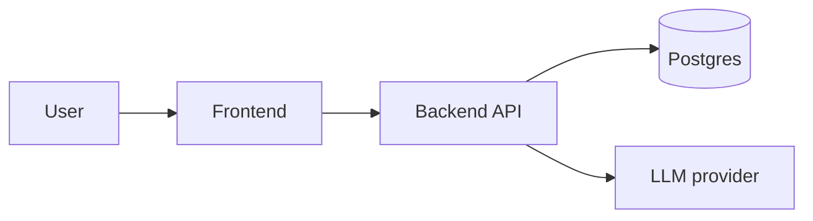

# Documentation

## TL;DR

- Documentation is **Markdown in the repository**, in simple English, and changes in the **same PR** as the code.
- The `README.md` follows the [template](../../templates/docs/README.md). Everything else is in `docs/`, with an index in `docs/README.md`.
- Structuring decisions are **ADRs** in `docs/adr/`, in the MADR format.
- Diagrams are **Mermaid** code in the Markdown, not images without source.
- HTTP APIs are described by their **OpenAPI** schema, generated from the code.
- At Level 2, Markdown is linted and links are checked in CI.

This repository applies these rules to itself: see [`docs/README.md`](../README.md) and [`docs/adr/`](../adr/README.md).

## What goes where

| Document | Location | For |
|---|---|---|
| What the project is, how to run it in 5 minutes, status, badges | `README.md` ([FILE-001](required-files.md#file-001-readmemd-follows-the-dah-labs-template)) | everybody |
| How to set up, test and contribute | `CONTRIBUTING.md` ([FILE-004](required-files.md#file-004-contributingmd-lets-a-newcomer-set-up-the-project-in-less-than-10-minutes)) | contributors |
| Index of the documentation | `docs/README.md` | everybody |
| Architecture overview, with a diagram | `docs/architecture.md` | contributors, reviewers |
| Decisions | `docs/adr/NNNN-title.md` | maintainers, future contributors |
| HTTP API | `docs/api/openapi.json` (generated) | frontend, partners |
| Operations: configuration, deployment, data refresh | `docs/operations.md` | maintainers |
| Code documentation | docstrings ([PY-011](python.md#py-011-public-api-has-google-style-docstrings)) and TSDoc comments | contributors |
| Models and datasets | `MODEL_CARD.md`, `DATASET_CARD.md` ([ML-004](ml-research.md#ml-004-every-published-model-has-a-model-card)) | users, partners |

## Rules

### DOC-001: Documentation is in simple English

**MUST** · Level 1 · Verified by: code review (manual)

- Short sentences, active voice, common words. Many readers use English as a second or third language, and some use a translator.
- Define a term the first time it appears, or link to a glossary.
- Use RFC 2119 keywords (MUST, SHOULD, MAY) only for rules.
- A project MAY add translated pages (for example a French getting started page, like [this repository](../getting-started/demarrage-fr.md)); the English page stays the reference.

### DOC-002: `docs/` has an index, and pages are written for a task

**SHOULD** · Level 1 · Verified by: `docs/README.md` exists (manual)

- `docs/README.md` lists every page with one line about it.
- A page answers one question ("How do I add a document source?"), starts with a short summary, and gives commands that can be copied.
- Long pages start with a **TL;DR** of 3 to 6 lines.

### DOC-003: The architecture is described on one page, with a diagram

**SHOULD** · Level 2 · Verified by: `docs/architecture.md` review (manual)

`docs/architecture.md` shows the parts of the system (frontend, backend, workers, databases, external APIs) and how they talk, in one Mermaid diagram, then explains the layers of the code ([Architecture](architecture.md)) and the main data flows.

### DOC-004: Structuring decisions are recorded in ADRs

**MUST** · Level 2 · Verified by: `docs/adr/` review (manual)

- Use the [ADR template](../../templates/docs/adr.md) (MADR 4.0). Name files `NNNN-short-title.md`, with the next free number.
- Write an ADR for a decision that is hard to change: a framework, a database or vector store, a model provider, a split into services, an exception to a MUST rule of these standards.
- An ADR starts as `proposed` in a PR; it becomes `accepted` when the PR is merged. A decision that changes gets a **new** ADR that supersedes the old one; the old one is not rewritten.
- `docs/adr/README.md` lists the ADRs with their status.

**Why:** six months later, nobody remembers why. An ADR stops the same discussion from happening again, and explains the code to newcomers.

### DOC-005: Diagrams are code (Mermaid)

**SHOULD** · Level 1 · Verified by: code review (manual)

GitHub renders [Mermaid](https://mermaid.js.org/) blocks in Markdown. A diagram in code is reviewed in diffs and updated with the code.

````markdown

````

An image (PNG, SVG) is acceptable for screenshots or when Mermaid cannot draw it; keep its source file (draw.io, Excalidraw) next to it.

### DOC-006: The HTTP API is described by an OpenAPI schema generated from the code

**SHOULD** · Level 2 · Verified by: CI check that `docs/api/openapi.json` is up to date (automatic)

- FastAPI generates the schema. Give every route a `summary`, response models and error responses.
- Export it to `docs/api/openapi.json` with a small script (`uv run python -m my_package.interfaces.http.export_openapi`), and check in CI that the committed file is up to date (`git diff --exit-code`).
- The frontend MAY generate its API types from this file ([ARCH-010](architecture.md#arch-010-the-frontend-calls-the-backend-through-one-typed-api-client)).

### DOC-007: Documentation changes in the same PR as the code

**MUST** · Level 1 · Verified by: PR template checkbox and code review (manual)

A PR that changes a behavior, a command, a setting or an environment variable updates the README, `docs/`, `.env.example` and the docstrings in the same PR.

**Why:** documentation written "later" is never written, and wrong documentation is worse than none.

### DOC-008: Markdown is linted and links are checked in CI

**SHOULD** · Level 2 · Verified by: pre-commit hooks and CI (automatic)

Add the hooks used by this repository to `.pre-commit-config.yaml`, and copy [`.markdownlint.yaml`](../../.markdownlint.yaml) and [`lychee.toml`](../../lychee.toml):

```yaml
  - repo: https://github.com/igorshubovych/markdownlint-cli
    rev: v0.50.0
    hooks:
      - id: markdownlint
  - repo: https://github.com/lycheeverse/lychee
    rev: lychee-v0.24.2
    hooks:
      - id: lychee
        args: [--offline, --no-progress] # internal links and anchors; external links in CI
```

Check external links in a scheduled CI job (weekly), not on every PR, so that a website that is down does not block a contributor.

### DOC-009: A documentation site is optional and built from the same Markdown

**MAY** · Level 3 · Verified by: GitHub Pages deployment (manual)

A project MAY publish its `docs/` folder on GitHub Pages with a static site generator, deployed by `actions/deploy-pages` from `main`. The Markdown stays readable on GitHub, with relative links, so the site is never required.

> ⚠️ To verify before you choose a generator: its maintenance status. For example, the maintainers of Material for MkDocs announced the end of its maintenance; check the current situation and the recommended successor.

## Checklist

- [ ] `README.md` follows the template; `docs/README.md` indexes every page.
- [ ] Documentation is in simple English and was updated in the same PR as the code.
- [ ] `docs/architecture.md` has a Mermaid diagram (Level 2).
- [ ] Structuring decisions have ADRs in `docs/adr/`, listed in `docs/adr/README.md`.
- [ ] The OpenAPI schema is exported to `docs/api/openapi.json` and checked in CI (Level 2).
- [ ] markdownlint and lychee run in pre-commit and CI (Level 2).

---

*Last verified: 2026-11-14.*
