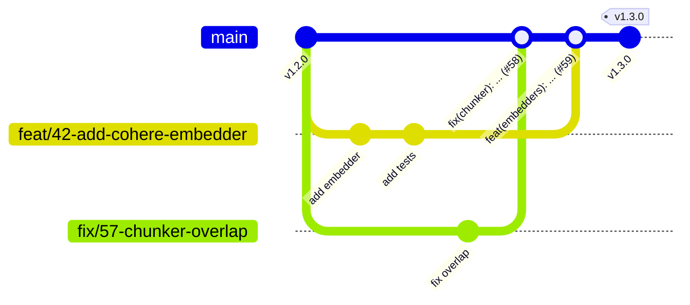

# Git branching

## TL;DR

- We use **GitHub Flow** (trunk-based development): `main` is the only long-lived branch.
- `main` is protected and always deployable. Nobody pushes to it directly.
- Every change lives on a short branch (less than 2 weeks), created from `main` and merged by pull request.
- Branch names follow `<type>/<issue-number>-<short-description>`, for example `feat/42-add-cohere-embedder`.
- A pre-push hook and a CI check enforce the name.

## The model in one picture



Each pull request is **squash merged**: one branch becomes one commit on `main` (see [Commits](commits.md)).

## Rules

### GIT-001: `main` is the only long-lived branch and the default branch

**MUST** · Level 1 · Verified by: GitHub settings audit (manual, `gh repo view --json defaultBranchRef`)

Every repository has exactly one long-lived branch, named `main`. It is the default branch. There is no `develop`, `development`, `staging` or `release` branch.

**Why:** one integration branch means one place to look, no merges between long-lived branches and no "which branch is the real one?" questions for new contributors. Releases are tags on `main` (see [Releases](releases.md)).

**Examples:**

- ✅ Default branch `main`; releases tagged `v1.3.0` on `main`.
- ❌ Default branch `development`, with `main` updated "from time to time" by a merge.

A repository that uses `development` today follows the [default branch migration guide](../migration/default-branch-migration.md).

### GIT-002: Nobody pushes directly to `main`

**MUST** · Level 1 · Verified by: GitHub ruleset on `main` (automatic) and `dah-branch-name` pre-push hook

All changes reach `main` through a pull request. The ruleset blocks direct pushes, force pushes and deletion of `main` (see [GitHub settings](github-settings.md)). The pre-push hook stops the push on your machine before GitHub rejects it.

**Why:** a pull request gives a review, a CI run and a written record of every change.

**Examples:**

- ✅ `git push -u origin fix/57-chunker-overlap`, then open a pull request.
- ❌ `git push origin main`.

### GIT-003: Branch names follow `<type>/<issue-number>-<short-description>`

**MUST** · Level 1 · Verified by: `dah-branch-name` pre-push hook and `pr-conventions.yml` CI check (automatic)

- `<type>` is one of the types in the table below.
- `<issue-number>` is the number of the GitHub issue. If there is no issue, omit it: `<type>/<short-description>`.
- `<short-description>` is 2 to 5 English words in **kebab-case**: lower-case letters, digits and hyphens only.
- The full name is at most 60 characters.

| Type | Use it for | Matching commit type |
|---|---|---|
| `feat` | A new feature | `feat` |
| `fix` | A bug fix | `fix` |
| `docs` | Documentation only | `docs` |
| `refactor` | Code change that keeps the behavior | `refactor` |
| `test` | Tests only | `test` |
| `chore` | Maintenance (dependencies, tooling) | `chore` |
| `ci` | CI workflows | `ci` |
| `build` | Build system, Docker, packaging | `build` |
| `perf` | Performance improvement | `perf` |
| `hotfix` | Urgent fix of a production problem | `fix` |
| `exp` | Research experiment (see GIT-006) | none: never merged as is |

The exact regular expression is:

```text
^(feat|fix|docs|refactor|test|chore|ci|build|perf|hotfix|exp)/([0-9]+-)?[a-z0-9]+(-[a-z0-9]+)*$
```

Bot branches (`dependabot/…`, `release-please--…`) are not checked.

**Why:** the name tells reviewers what the branch does and which issue it closes, without opening it. A fixed format can be checked by a machine.

**Examples:**

- ✅ `feat/42-add-cohere-embedder`
- ✅ `fix/57-chunker-overlap`
- ✅ `docs/contributing-setup`
- ❌ `john`, `mary-work`, `sprint-4` (a person or a period: the name does not say what the branch does)
- ❌ `feature/add_embedder` (wrong type, underscore)
- ❌ `fix/issue-10-the-answer-is-empty-when-the-question-has-no-match` (too long)

**How to apply it:**

- On your machine: the `dah-branch-name` hook runs on `git push` (see [Git hooks](git-hooks.md)).
- In CI: the reusable workflow [`pr-conventions.yml`](../../.github/workflows/pr-conventions.yml) checks the source branch of every pull request.
- To fix a wrong name before pushing: `git branch -m feat/42-add-cohere-embedder`.
- If the pull request is already open, push the branch under the new name, open a new pull request and close the old one with a link to the new one.

### GIT-004: Branches start from an up-to-date `main`

**SHOULD** · Level 1 · Verified by: code review (manual)

```bash
git switch main
git pull --ff-only
git switch -c feat/42-add-cohere-embedder
```

**Why:** a branch that starts from an old `main` creates conflicts and hides integration problems until the end.

### GIT-005: Branches are short-lived

**SHOULD** · Level 1 · Verified by: monthly review of open branches (manual, `git branch -r --sort=-committerdate`)

A branch lives less than **2 weeks**. If the work is bigger, split it into several pull requests that each leave `main` working. Unfinished features can be hidden behind a configuration flag.

**Why:** long branches drift away from `main`. Their final merge is large, risky and hard to review.

**Examples:**

- ✅ Three pull requests over two weeks: "add the `IReranker` port", "add the Cohere adapter", "enable the reranker in `premium.yaml`".
- ❌ One `feat/reranker` branch open for two months, with 3 000 changed lines.

### GIT-006: `exp/` branches are never merged as they are

**MUST NOT** · Level 1 · Verified by: code review (manual)

`exp/` branches are for research experiments: quick notebooks, trial configurations, throw-away code. They MAY live longer than 2 weeks and MAY skip some checks. They MUST NOT be merged into `main` directly. To keep the result of an experiment, open a new `feat/` or `docs/` branch with clean code, tests and a short report (see [ML and research](ml-research.md)).

**Why:** experiments are useful, but their code is not written to be maintained.

### GIT-007: Merged branches are deleted

**MUST** · Level 1 · Verified by: repository setting "Automatically delete head branches" (automatic)

After a merge, GitHub deletes the branch. Delete your local copy too: `git fetch --prune` then `git branch -d <branch>`.

**Why:** a list of branches should show the work in progress, not the history. The history is in `main`.

### GIT-008: Shared branches are never rewritten

**MUST NOT** · Level 1 · Verified by: code review (manual)

You MAY rebase or force-push **your own** branch before review (`git push --force-with-lease`). You MUST NOT force-push a branch that someone else works on, and MUST NOT rewrite `main` (the ruleset blocks it).

To update your branch with the latest `main`, use either:

```bash
git fetch origin
git rebase origin/main          # linear history; then: git push --force-with-lease
# or
git merge origin/main           # no rewrite; fine because the PR is squash merged
```

**Why:** rewriting a shared branch deletes the work of other people.

## Hotfixes

There is no special hotfix branch model. A hotfix is a normal short branch named `hotfix/<issue>-<description>`, created from `main` and merged by pull request. The reviewer gives it priority. After the merge, release-please opens a patch release (for example `v1.3.1`).

## Checklist

- [ ] The default branch is `main` and there is no other long-lived branch.
- [ ] A ruleset blocks direct pushes, force pushes and deletion on `main`.
- [ ] The `dah-branch-name` pre-push hook is configured in `.pre-commit-config.yaml`.
- [ ] CI calls `pr-conventions.yml` and the branch name check is green.
- [ ] "Automatically delete head branches" is enabled.
- [ ] No branch is named after a person.
- [ ] No branch is older than 2 weeks without a reason written in its pull request.

---

*Last verified: 2026-11-13.*
