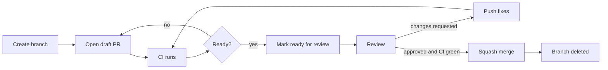

# Pull requests

## TL;DR

- Every change reaches `main` through a pull request (PR) that uses the repository template.
- One PR = one topic, ideally **less than 400 changed lines** (generated files excluded).
- Open the PR as a **draft** until it is ready for review.
- To merge: CI green, **1 approval** from a code owner (2 for architecture or security changes), all conversations resolved.
- The PR title follows Conventional Commits, because it becomes the commit message on `main`.

## Life of a pull request

## Rules

### PR-001: Every PR uses the template and fills every section

**MUST** · Level 1 · Verified by: `.github/pull_request_template.md` present (automatic); code review (manual)

The template ([`templates/github/pull_request_template.md`](../../templates/github/pull_request_template.md)) asks for:

1. **Context:** why the change is needed; link to the issue.
2. **Changes:** what the PR changes, as a short list.
3. **How to test:** the exact commands or steps a reviewer can run.
4. **Screenshots:** for any change to a user interface.
5. **Checklist:** tests, documentation, no secrets, no real personal data.

Write "N/A" in a section that does not apply. Do not delete it.

**Why:** a reviewer who knows the context reviews faster and better. The PR description is the documentation of the change.

### PR-002: A PR is linked to an issue

**SHOULD** · Level 1 · Verified by: code review (manual)

Use `Closes #123` in the description (GitHub then closes the issue at merge). Small changes (typo, dependency update) MAY have no issue.

**Why:** the issue holds the discussion about *what* to do; the PR holds the discussion about *how*.

### PR-003: A PR changes less than 400 lines

**SHOULD** · Level 1 · Verified by: code review (manual; the line count is shown in the "Files changed" tab)

Count added plus deleted lines, without lock files (`uv.lock`, `pnpm-lock.yaml`), generated code and test fixtures. Above 400 lines, split the PR. Useful ways to split:

- **Preparation first:** a `refactor:` PR that prepares the code, then a `feat:` PR that adds the feature.
- **By layer:** the port (interface) and its tests, then the adapter, then the API route.
- **Mechanical changes alone:** a rename or a reformatting goes in its own PR, without logic changes.

**Why:** studies of code review show that reviewers find fewer defects in large changes. A volunteer can review 200 lines in one evening; nobody reviews 3 000 lines well.

### PR-004: A PR is opened as a draft until it is ready

**SHOULD** · Level 1 · Verified by: code review (manual)

Open a **draft** PR early to show your direction and get CI feedback. Click **Ready for review** only when CI is green and the template is filled. Reviewers do not review drafts unless the author asks a question.

### PR-005: A PR has one topic

**MUST** · Level 1 · Verified by: code review (manual)

Do not mix a feature, an unrelated fix and a reformatting in one PR.

- ✅ `fix(chunker): stop infinite loop when overlap is larger than chunk size`
- ❌ `fix: chunker loop, update README, bump fastapi, rename files`

### PR-006: A PR needs at least 1 approval from a code owner

**MUST** · Level 1 · Verified by: ruleset `required_approving_review_count: 1` and `require_code_owner_review: true` (automatic)

The `.github/CODEOWNERS` file assigns reviewers automatically (see [Required files](required-files.md#file-008-githubcodeowners-names-a-team-never-a-person)). The author cannot approve their own PR (GitHub enforces it).

### PR-007: Architecture, security and CI changes need 2 approvals

**SHOULD** · Level 2 · Verified by: code review (manual); CODEOWNERS entries for sensitive paths (automatic)

A change to the architecture (new layer, new port, new dependency direction), to security (authentication, secrets, permissions) or to CI workflows needs **2 approvals**. The ruleset cannot ask for 2 approvals on some files only, so:

- add the label `needs-2-reviews`;
- the first reviewer approves and does not merge;
- the second reviewer approves and merges.

**Why:** these changes are hard to undo and affect everybody.

### PR-008: CI is green before merge

**MUST** · Level 1 · Verified by: ruleset required status checks (automatic)

The required checks are listed in the ruleset (see [GitHub settings](github-settings.md)). Nobody merges with a red check, even "just this once". A flaky test is a bug: open an issue and fix or quarantine the test.

### PR-009: All review conversations are resolved before merge

**MUST** · Level 1 · Verified by: ruleset `required_review_thread_resolution: true` (automatic)

The person who opened a conversation resolves it, after the author answers or pushes a fix (see [Code review](code-review.md)).

### PR-010: Approvals are dismissed when new commits are pushed

**MUST** · Level 1 · Verified by: ruleset `dismiss_stale_reviews_on_push: true` (automatic)

**Why:** an approval is for the code that the reviewer read, not for code pushed later.

### PR-011: UI changes include screenshots

**SHOULD** · Level 1 · Verified by: code review (manual)

Add "before" and "after" screenshots, or a short screen recording, for any visible change. Use fake data only (see [Security](security.md)).

### PR-012: The author keeps the PR moving

**SHOULD** · Level 1 · Verified by: monthly review of open PRs (manual)

- Answer review comments within **5 working days**, or say when you will.
- If you cannot finish, say so in the PR: a maintainer can take it over or close it.
- A PR without activity for **30 days** MAY be closed by a maintainer, with a kind message. It can be reopened at any time.

## Who merges

The **author** merges when they have write access, CI is green and the approvals are there. Otherwise a **maintainer** merges. Use **Squash and merge** (the only option), check that the commit title is the PR title, and keep the PR description as the commit body.

## Checklist

- [ ] The repository has `.github/pull_request_template.md`.
- [ ] The ruleset requires 1 approval, code owner review, resolved conversations, and dismisses stale approvals.
- [ ] The ruleset lists the required status checks.
- [ ] The label `needs-2-reviews` exists.
- [ ] Open PRs older than 30 days were reviewed this month.

---

*Last verified: 2026-11-13.*
