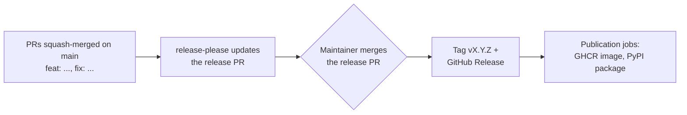

# Versioning and releases

## TL;DR

- Versions follow **Semantic Versioning** (`MAJOR.MINOR.PATCH`). Each release is a Git tag `vX.Y.Z` and a **GitHub Release** with notes.
- At Level 2, **release-please** does the work: it reads the Conventional Commits on `main`, keeps a **release PR** open with the next version and the CHANGELOG, and creates the tag and the GitHub Release when a maintainer merges that PR.
- Nobody edits version numbers or creates tags by hand. Nothing is published (image, package, model) except from a release.
- The release PR is opened with a **GitHub App token**, so that its checks run like on any other PR.

Start from [`templates/release/`](../../templates/release/) and [`templates/github/workflows/release.yml`](../../templates/github/workflows/release.yml).

## How a release happens



1. Contributors merge PRs on `main` with Conventional Commit titles ([COM-001](commits.md#com-001-commit-messages-follow-conventional-commits-100)).
2. On each push to `main`, release-please updates **one** open PR named `chore(main): release X.Y.Z`. It contains the new version in every version file and the new CHANGELOG section.
3. When the maintainers want to release, they merge that PR (after its checks pass).
4. release-please then creates the `vX.Y.Z` tag and the GitHub Release. The jobs that publish artifacts run only in this case.

The commit types decide the version:

| Commits since the last release | Next version from `1.4.2` | Before `1.0.0` (with `bump-minor-pre-major`) |
|---|---|---|
| Only `fix:` (or `perf:`) | `1.4.3` | `0.4.2` → `0.4.3` |
| At least one `feat:` | `1.5.0` | `0.4.2` → `0.5.0` |
| At least one breaking change (`feat!:` or `BREAKING CHANGE:` footer) | `2.0.0` | `0.4.2` → `0.5.0` |
| Only `docs:`, `chore:`, `ci:`, `test:`, `refactor:` | no release | no release |

## Set up release-please in a repository

1. Copy [`templates/release/release-please-config.json`](../../templates/release/release-please-config.json) to `release-please-config.json` and [`templates/release/release-please-manifest.json`](../../templates/release/release-please-manifest.json) to `.release-please-manifest.json`, at the root.
2. In the manifest, write the **current** version (the version in `pyproject.toml` or `package.json`, or `0.1.0` for a new project).
3. In the configuration, list every file that contains the version in `extra-files`. The template covers `backend/pyproject.toml`, the project entry in `backend/uv.lock` and `frontend/package.json`. Replace `TODO-package-name` with the `name` of `pyproject.toml`.
4. Copy [`templates/github/workflows/release.yml`](../../templates/github/workflows/release.yml) to `.github/workflows/release.yml`.
5. Configure the GitHub App of the organization ([REL-005](#rel-005-the-release-pr-is-opened-with-a-github-app-token)).
6. Push to `main`. The first release PR appears. Check its version and CHANGELOG before you merge it.

The template uses one version for the whole repository (`"."` with the `simple` strategy). It fits a product repository with a backend and a frontend that are released together. For a Python library at the root, use `"release-type": "python"` for `"."`, and keep the `uv.lock` entry in `extra-files`.

### Why `uv.lock` is in `extra-files`

`uv.lock` contains the version of the project itself. If release-please updated only `pyproject.toml`, the lock file would be outdated and `uv sync --locked` would fail in CI on the release PR. release-please does not know `uv.lock`, so the template updates it as a TOML file. The JSONPath `$.package[?(@.name.value=='my-package')].version` selects the project entry. This was tested with release-please 17.6.0 (the version in `release-please-action` v5.0.0) and uv 0.13.8: `uv lock --check` passes after the update.

### The first release and special versions

- To choose the version of the next release, add a footer to a commit on `main`: `Release-As: 1.0.0`. Use an empty commit if needed: `git commit --allow-empty -m "chore: release 1.0.0" -m "Release-As: 1.0.0"`.
- To release `1.0.0` from `0.x`, do the same. `1.0.0` means the public API is stable ([REL-007](#rel-007-100-is-released-when-the-public-api-is-stable)).

## Rules

### REL-001: Versions follow Semantic Versioning, and tags are `vX.Y.Z`

**MUST** · Level 1 · Verified by: tag list review (manual); release-please (automatic, Level 2)

- Versions follow [Semantic Versioning 2.0.0](https://semver.org/spec/v2.0.0.html).
- Tags are `v` + the version: `v1.4.0`. No other tag format (`1.4.0`, `release-1.4`, `prod`).
- Pre-releases MAY use SemVer suffixes: `v2.0.0-rc.1`.

**Why:** tools (release-please, Dependabot, `docker/metadata-action`, PyPI) understand SemVer, and users know what a version number promises.

### REL-002: Each release is a GitHub Release with notes

**MUST** · Level 1 · Verified by: Releases page of the repository (manual)

The notes list the user-visible changes. At Level 1 they MAY be written by hand (or with **Generate release notes**). At Level 2 release-please writes them from the CHANGELOG.

### REL-003: release-please creates the versions, tags and CHANGELOG

**MUST** · Level 2 · Verified by: `release.yml` calls `release-please.yml@v1` (automatic); audit checklist (manual)

- Version numbers in files are changed **only** by the release PR.
- Tags are created **only** by release-please.
- `CHANGELOG.md` is generated; do not edit the generated sections by hand. To fix a release note, edit the GitHub Release.

**Why:** the version and the notes come from the commits, so they are always consistent and nobody forgets a step.

**Examples:**

- ✅ Merge the PR `chore(main): release 1.5.0` opened by release-please.
- ❌ `git tag v1.5.0 && git push --tags`, or a PR that changes `version = "1.5.0"` by hand.

### REL-004: The configuration and the manifest are at the root, and cover every version file

**MUST** · Level 2 · Verified by: code review (manual); `uv sync --locked` in CI on the release PR (automatic)

- `release-please-config.json` and `.release-please-manifest.json` are at the root.
- Every file that contains the version is updated by the release PR (`extra-files`): `pyproject.toml`, `uv.lock`, `package.json`, a `__version__` if any.
- Prefer one source for the version in the code: read it with `importlib.metadata.version("<package>")` instead of a `__version__` constant.

### REL-005: The release PR is opened with a GitHub App token

**SHOULD** · Level 2 · Verified by: checks run on the release PR (manual)

Pull requests and tags created with the default `GITHUB_TOKEN` **do not start other workflows**. With it, the release PR has no checks, so the ruleset blocks its merge, and the tag does not start the publication workflows.

Set up once for the organization (an owner does it):

1. Create a GitHub App owned by the organization (**Settings → Developer settings → GitHub Apps → New GitHub App**), for example `dah-release-bot`. No webhook. Repository permissions: **Contents: read and write**, **Pull requests: read and write**, **Issues: read and write** (labels), **Metadata: read**.
2. Generate a private key. Install the App on the repositories that use release-please.
3. Store the **Client ID** as the organization variable `RELEASE_APP_CLIENT_ID` and the private key as the organization secret `RELEASE_APP_PRIVATE_KEY`, available to those repositories.

Without the App, `release-please.yml` falls back to `GITHUB_TOKEN` and writes a warning. The repository then needs **Settings → Actions → General → Allow GitHub Actions to create and approve pull requests** ([GH-012](github-settings.md#gh-012-the-workflow-token-is-read-only-by-default)), and a maintainer **closes and reopens** the release PR to start its checks.

**Why:** a GitHub App token is short-lived (one hour) and belongs to no person, unlike a personal access token.

### REL-006: Artifacts are published only from a release

**MUST** · Level 2 · Verified by: workflow review (manual)

Publication jobs run in `release.yml`, after the `release` job, with `if: needs.release.outputs.release_created == 'true'`, and use the released version. See [Continuous delivery without infrastructure](ci-cd.md#continuous-delivery-without-infrastructure).

- Container images: `docker.yml@v1` with `push: true` and `version`. Tags `X.Y.Z`, `X.Y` and `latest`.
- Python packages: PyPI Trusted Publishing (`uv publish --trusted-publishing always`), in a protected `pypi` environment.

### REL-007: `1.0.0` is released when the public API is stable

**SHOULD** · Level 2 · Verified by: code review of the release PR (manual)

- Before `1.0.0`, `bump-minor-pre-major: true` makes breaking changes bump the minor version (`0.4.2` → `0.5.0`).
- Release `1.0.0` when other projects or users depend on the API (HTTP endpoints, Python package, CLI, model format). After `1.0.0`, every breaking change bumps the major version.

### REL-008: Tags are never moved or deleted

**MUST** · Level 1 · Verified by: GitHub ruleset on tags (automatic, when configured); code review (manual)

A published version never changes. To fix a release, publish a new patch version.

The only exception is the **major tag** of a repository that publishes reusable workflows or actions (`v1` in this repository). It moves to each new `1.x.y` release, automatically (`move-major-tag: true` of `release-please.yml`).

### REL-009: Released artifacts have a build provenance attestation

**SHOULD** · Level 3 · Verified by: `gh attestation verify` (manual)

`docker.yml` attests the provenance of pushed images with `actions/attest-build-provenance`. Users verify an image with:

```bash
gh attestation verify oci://ghcr.io/dah-projects-and-innovations/<image>:<version> \
  --owner DAH-Projects-and-Innovations
```

## Versions of this repository

The engineering standards follow the same rules, see [CONTRIBUTING.md](../../CONTRIBUTING.md#versions). Projects call the reusable workflows with `@v1`, the moving major tag. Breaking changes (a removed input, a new required check name) go to `v2`.

## Checklist

- [ ] Tags are `vX.Y.Z` and each one has a GitHub Release.
- [ ] `release-please-config.json` and `.release-please-manifest.json` are at the root; the manifest has the current version.
- [ ] `extra-files` covers every version file, including `uv.lock`.
- [ ] `.github/workflows/release.yml` calls `release-please.yml@v1` on pushes to `main`.
- [ ] The release PR is opened with the GitHub App token, and its checks run.
- [ ] Publication jobs run only when `release_created` is `true`.

---

*Last verified: 2026-11-14.*
