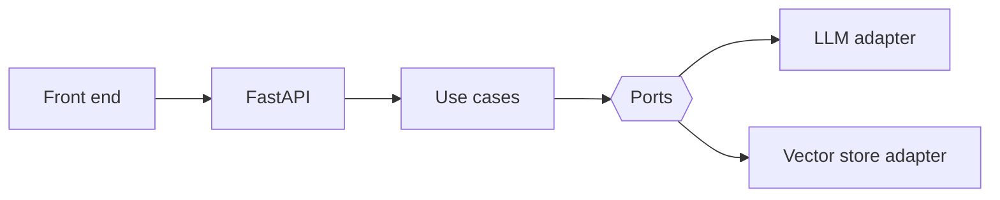

<!--
DAH Labs README template (rule FILE-001). Copy to README.md and replace every TODO.
Keep the section order. Delete the HTML comments when you are done.
-->

# TODO Project name

TODO: one sentence that says what the project does and for whom.

<!-- Badges. Replace <repo> and <sonar-project-key>. The Sonar badges are Level 2. -->
[](https://github.com/DAH-Projects-and-Innovations/<repo>/actions/workflows/ci.yml)
[](https://sonarcloud.io/summary/new_code?id=<sonar-project-key>)
[](https://sonarcloud.io/summary/new_code?id=<sonar-project-key>)
[](LICENSE)
[](https://github.com/DAH-Projects-and-Innovations/engineering-standards/blob/main/docs/compliance/levels.md)

## Status

<!-- One of: experimental, active, maintained, archived. Say what works and what does not. -->
**TODO: active.** TODO: what is ready, what is not, and whether it can be used in production.

## Quick start

<!-- The shortest path to see the project work. Usually Docker Compose. -->

```bash
git clone https://github.com/DAH-Projects-and-Innovations/<repo>.git
cd <repo>
cp .env.example .env
docker compose up
```

- Web interface: <http://localhost:3000>
- API and interactive documentation: <http://localhost:8000/docs>

## Architecture

TODO: one paragraph. Link to `docs/architecture.md` for details.



## Development

Requirements: Python 3.12+ and [uv](https://docs.astral.sh/uv/), Node.js 24 and pnpm, Docker.

```bash
# Back end
cd backend
uv sync
uv run pytest

# Front end
cd frontend
pnpm install
pnpm dev

# Git hooks (once)
uvx pre-commit install
```

See [CONTRIBUTING.md](CONTRIBUTING.md) for the full setup, the conventions and how to open a pull request.

## Tests

```bash
cd backend && uv run pytest                 # unit tests (fast, no network)
cd backend && uv run pytest -m integration  # needs docker compose up postgres redis
cd frontend && pnpm test
```

## Contributing

Contributions are welcome: code, documentation, evaluation data, bug reports. Start with the issues labeled [good first issue](https://github.com/DAH-Projects-and-Innovations/<repo>/labels/good%20first%20issue), and read [CONTRIBUTING.md](CONTRIBUTING.md) and the [Code of Conduct](CODE_OF_CONDUCT.md).

Security problems: see [SECURITY.md](SECURITY.md). Never open a public issue for a vulnerability.

## License

TODO: Apache License 2.0, see [LICENSE](LICENSE). Documentation is licensed under CC BY 4.0.
<!-- If an exception applies (FILE-003), explain it here and link the ADR. -->

## Citation

<!-- Research repositories: keep this section and add CITATION.cff. Others: delete it. -->
If you use this work, please cite it with the "Cite this repository" button on GitHub, or:

```bibtex
@software{TODO,
  title  = {TODO},
  author = {{DAH Labs}},
  year   = {TODO},
  url    = {https://github.com/DAH-Projects-and-Innovations/<repo>}
}
```

---

A [DAH Labs](https://github.com/DAH-Projects-and-Innovations) project — Data Afrique Hub.
